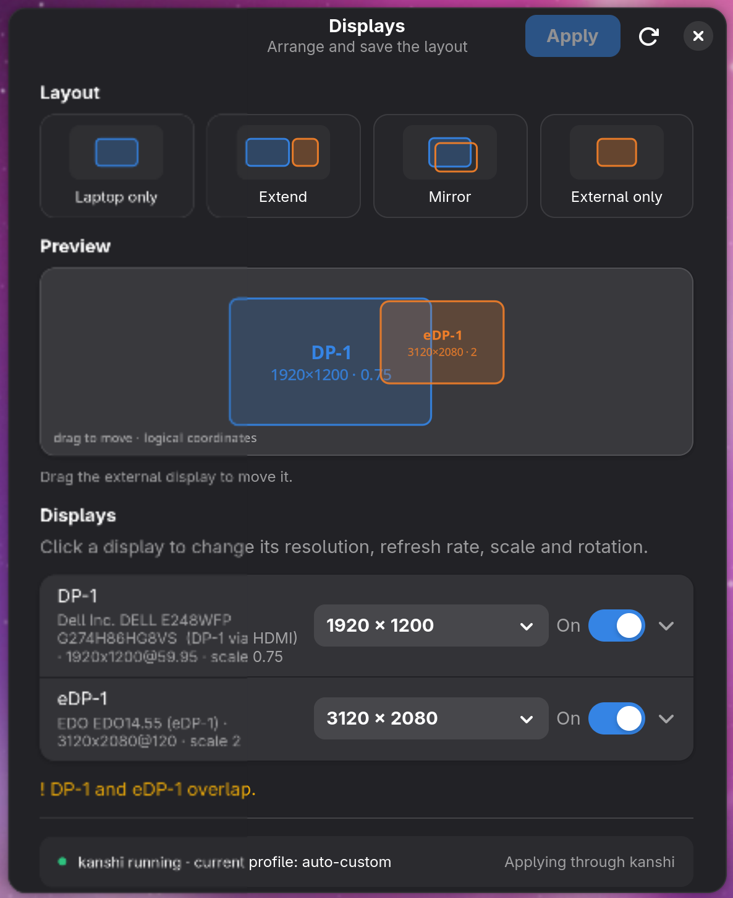

# kanshi-gtk4



Arrange displays on Wayland and save the layout as a
[kanshi](https://gitlab.freedesktop.org/emersion/kanshi) profile — a small
GTK4 / libadwaita app.

Pick a preset, the layout applies immediately, and a detached watchdog puts the
old one back after 10 seconds unless you click **Keep**. Keeping the layout
writes it to `~/.config/kanshi/config`, so it survives reboot and hotplug.

## Features

- Four one-click layouts: **Laptop only**, **Extend**, **Mirror**, **External only**.
- Per-output resolution, refresh rate, scale, rotation, adaptive sync and
  enabled/disabled controls.
- Lower custom resolutions for panels that advertise only their native size.
- Live, to-scale preview; drag the external display and it snaps flush to the
  closest edge of the other screen.
- 10-second countdown with **Keep** / **Revert**, plus a detached watchdog that
  restores the previous layout even if the app crashes or is killed.
- A marked kanshi block that survives hand-written profiles and is applied at
  login and on hotplug.
- Read-only startup: nothing is changed or written until you press Apply.

## Requirements

- **GTK 4.18+ / libadwaita 1.7+** — the oldest GUI stack the source builds
  against, which also makes the app installable on Debian 13 (trixie).
- **labwc, niri, sway (1.11+), COSMIC (cosmic-comp 1.11+) or Hyprland
  (0.52.1+)** — supported compositors. All implement `zwlr_output_manager_v1`,
  the protocol this app drives; Hyprland does so only partially (see the note
  below). Other compositors exposing the same protocol may work but are
  untested. **GNOME and KDE are not supported** (they do not expose the
  protocol).
- [kanshi](https://gitlab.freedesktop.org/emersion/kanshi) — optional, needed
  to persist the layout across reboot and hotplug.
- `wlr-randr` — **no longer required**. The app speaks
  `zwlr_output_manager_v1` natively through `wayland-client`; the old
  shell-out backend is only kept as an opt-in debugging fallback
  (`KANSHI_GTK4_BACKEND=wlr-randr`). COSMIC mirroring still uses
  `cosmic-randr` when available.

```sh
sudo pacman -S kanshi
```

### Compositor support

| Compositor | `zwlr_output_manager_v1` | Status |
|---|---|---|
| labwc | yes, v4 verified | supported |
| niri | yes, v4 verified (26.04+) | supported |
| sway | yes, v4 (1.11+) | supported |
| river | yes, v4 (0.3.13+) | untested, should work |
| wayfire | yes, v4 (0.9+) | untested, should work |
| Cage / phoc | yes, v4 | untested, should work |
| COSMIC (cosmic-comp 1.11+) | yes, v4 verified | supported |
| Hyprland | yes, v4 (0.52.1+) | partial, see the note |
| GNOME / KDE | no | not supported |
| X11 / XWayland session | n/a | not supported |

> **sway users:** sway only gained `zwlr_output_manager_v1` (v4) in **1.11**, so
> the app sees no outputs on older sway. Debian 13 (trixie) ships sway 1.10.1,
> so on stock trixie + sway the app finds nothing to arrange. Check with
> `wayland-info | grep zwlr_output_manager` (no output means the protocol is
> missing) and use sway 1.11+ or a different compositor.

> **COSMIC users:** `cosmic-comp-traffic` 1.11.0 and later works: all four
> presets, dragging, scaling and the managed kanshi block were verified on it.
> Mirroring needs `cosmic-randr` (package `cosmic-randr`) or it falls back to
> two independent heads at the same position, which on COSMIC shows windows on
> the panel only.
> cosmic-comp keeps output positions as unsigned values, so a layout that would
> start at a negative coordinate is shifted into the positive quadrant
> (`external at -1920,0` comes back as `external 0,0 / panel 1920,0`). The app
> therefore normalises every layout to `0,0` before applying it and compares
> the result up to a global translation, so an external display placed on the
> left of the panel is no longer reverted. Disabling an output used to abort
> cosmic-comp through an `unwrap()` on the removed output's workspace set; those
> fixes ship in `cosmic-comp-traffic` 1:1.11.0-8 and later.

> **Hyprland users:** support is **partial**. Hyprland advertises
> `zwlr_output_manager_v1` v4 from 0.52.1 on, so the app lists the heads and
> can apply, keep and persist a layout like on wlroots. What it cannot do is
> win against Hyprland's own monitor state: `monitor=` lines in
> `hyprland.conf` (or `hl.monitor()`) are re-applied on config reload and
> override whatever came in over the protocol, and a `monitor=` rule plus a
> protocol-side setting can leave the output in a conflicting state.
> Rotation is the most fragile part: a `transform` sent through the protocol
> has been reported to break the image when a `monitor=` rule also exists for
> that output (regression from 0.55.4, see
> [hyprwm/Hyprland#15493](https://github.com/hyprwm/Hyprland/discussions/15493)).
> Practical advice: drop or update `monitor=` rules for outputs you want to
> arrange here, and set `transform` in the Hyprland config rather than in the
> app. Unlike labwc, niri and COSMIC, Hyprland was not part of the hardware
> testing below.

Tested on labwc 0.20.2, niri and cosmic-comp-traffic 1.11.0 with a Xiaomi Book
Pro 14 (eDP-1, 3120×2080) and a Dell E248WFP (1920×1200). Connector names,
modes, refresh rates and scales are read from the compositor at runtime:
nothing about a particular display is hardcoded, and each output has its own
resolution and refresh picker. EDID make/model/serial are used as a stable
identity, so layouts survive a dock or reboot that renames a connector.

## Build and run

```sh
cargo build --release
./target/release/kanshi-gtk4
```

### Arch Linux package

The repository ships a `PKGBUILD` for a local package (it is not published to
the AUR):

```sh
makepkg -si
# or, after building:
sudo pacman -U kanshi-gtk4-*.pkg.tar.zst
```

CI builds the same package for every `v*` tag and attaches it to the GitHub
release. The package installs the binary, desktop entry, icon and license.

### Debian / Ubuntu package

A `.deb` is built for every `v*` tag inside a Debian 13 container and attached
to the GitHub release, so it is linked against GTK 4.18 and libadwaita 1.7 and
also runs on newer releases:

```sh
sudo apt install ./kanshi-gtk4_*.deb
```

To build it yourself (needs `cargo` and `dpkg-deb`):

```sh
./packaging/build-deb.sh
sudo apt install ./dist/kanshi-gtk4_*.deb
```

The script skips debhelper and dh-cargo, because Debian 13's `rustc` is older
than the `rust-version` in `Cargo.toml`; it compiles with the cargo on `PATH`
and assembles the package tree by hand.

The `.deb` does not change compositor support: on trixie the GUI stack is old
enough, but sway 1.10.1 is not (see the sway note above).

## Usage

### Presets

| Preset | Internal | External |
|---|---|---|
| Laptop only | on, `0,0` | off |
| Extend | on, `0,0` | on, `x = internal_logical_w`, `y = 0` (draggable, snaps to an edge) |
| Mirror | on, `0,0` | on, `0,0` |
| External only | off | on, `0,0` |

With a single display, only the preset that makes sense is enabled: a lone
built-in panel enables **Laptop only**, a lone external monitor enables
**External only**, and the other cards are insensitive with a tooltip. On a
desktop or tablet every output counts as external, so two external monitors
can still Extend and Mirror.

### Per-output controls

Expand a display row to change resolution, refresh rate, scale, rotation,
adaptive sync, or turn the output off. Disabling an output keeps its settings
in the plan and greys out the controls. The internal panel is detected by
connector name (`eDP-*`, `LVDS-*`, `DSI-*`) or from the saved state.

When a panel advertises only one size, the resolution list also offers lower
aspect-preserving sizes marked `(custom)`. They are applied with the
compositor's custom-mode request and saved to kanshi as
`mode --custom WIDTHxHEIGHT@RATE`.

Drag the external rectangle in the preview to move it; while it is near the
laptop panel it is pulled in, and it always settles flush against the closest
side, aligned to the nearest edge or centre. This switches the layout to
**Custom** and keeps the live positions. The laptop panel stays at `0,0`.

### Apply, keep, revert

Press **Apply** to build and validate the plan, snapshot the current state,
spawn the watchdog and apply the layout. A modal countdown appears:

- **Enter** or **Keep** saves the layout.
- **Esc**, **Revert**, closing the window, or waiting 10 seconds restores the
  previous arrangement.
- If the app crashes or is killed, the detached watchdog restores it anyway.

**Apply** is disabled when the plan already matches the current outputs or
when validation fails.

### Command line

```
kanshi-gtk4                     # open the GUI
kanshi-gtk4 --print-config      # print the generated kanshi config and exit
kanshi-gtk4 --verbose           # diagnostics on stderr
kanshi-gtk4 --config PATH       # override the kanshi config path
kanshi-gtk4 --state-dir PATH    # override the app state directory
kanshi-gtk4 --revert DIR        # restore a pending transaction manually
kanshi-gtk4 --version
```

`--print-config` writes nothing; use it to preview the generated config.

## How it works

### Layout model

All positions are in the compositor's global **logical** coordinate space.
Logical size is the mode size divided by the scale, with 90°/270° rotation
swapping width and height. For example, 3120×2080 at scale 2 is 1560×1040;
1920×1200 at scale 1.5 is 1280×800.

Presets anchor the built-in panel at `0,0` and place the external display to
its right for Extend. A manual drag switches the plan to **Custom** and keeps
the live positions; the dragged display is magnetised to the closest side of
the other one and aligned to its nearest edge or centre. Changing mode, scale
or rotation in a preset recomputes the positions; disabling an output keeps its
settings. Before a layout is
applied or written to kanshi it is moved so that the top-left of the bounding
box is `0,0`: a layout is only meaningful up to a global translation, and this
keeps compositors that refuse negative coordinates (COSMIC) in sync with the
saved profile.

**Mirroring** places both outputs at `0,0`. Wayland has no clone-and-scale
operation, so each output renders its own viewport of the same scene; if the
logical sizes differ, one display shows a crop. The app chooses an external
scale that fits the external logical area inside the internal one:

```
scale_ext = max(ext_mode_w / internal_logical_w, ext_mode_h / internal_logical_h)
```

clamped to 0.5–3.0 and rounded to three decimals. For 1920×1200 against
1560×1040 this gives 1.231 and a 1560×975 external area; the UI shows a note
when the result is not exact.

**COSMIC is the exception:** it keeps a separate workspace set per output, so
two heads at `0,0` share the pointer but not the windows — the external display
stays empty and windows only show on the panel. The app therefore asks the
compositor for a real mirror, `cosmic-randr mirror <external> <internal>`, both
right after applying any layout whose heads sit at the same position and through
an `exec` line inside the generated profile, so a hotplug or profile switch
re-creates it too. This needs `cosmic-randr` in `PATH`; without it the app falls
back to the overlapping layout. `KANSHI_GTK4_NATIVE_MIRROR=1|0` forces the
behaviour on or off and `KANSHI_GTK4_COSMIC_RANDR=/path/to/cosmic-randr` picks
another binary.

**Validation** rejects zero enabled outputs, unknown modes, scales outside
0.5–3.0 and invalid logical sizes. Overlapping outputs outside Mirror are
warnings, unless they share the same origin: an exact overlap is a mirror on
any compositor. Generated profiles always keep at least one output enabled, so
a config produced by this app cannot make the desktop completely invisible.

### Apply engines

The app has two apply engines, selected at transaction start:

| Engine | When | Apply | Revert |
|---|---|---|---|
| kanshi | `kanshictl status` succeeds, the daemon uses the managed config path, and the file is writable | write provisional config, apply through the native protocol, `kanshictl reload` | restore the previous config bytes and reload |
| native | kanshi is missing or stopped, uses a custom `-c` path, or the config is not writable | protocol `test`, then `apply` | restore the output snapshot |

The app applies the layout itself and then hands the same profile to kanshi.
This is required because kanshi 1.9 on labwc ignores the enabled bit for a
head that is currently off, so Extend would leave the laptop panel dark. The
preview is still exactly what kanshi applies at login. If kanshi is not
running, the layout still applies; it just will not re-apply at login.

### Transactions and the watchdog

Every Apply creates `$XDG_RUNTIME_DIR/kanshi-gtk4/pending-<uuid>/` (mode 0700)
containing:

- `state.json` — engine, output snapshot, paths, app/watchdog PIDs;
- `config.before` / `state.before` — exact previous bytes;
- `candidate.config` / `state.after` — what will be saved on Keep;
- `marker` — `keep` or `cancel`, written by the UI;
- `watchdog.log`.

The watchdog is spawned before the first change and polls the marker every
100 ms for 10 seconds. No marker means the app crashed or was killed, so it
restores the previous config and output snapshot, logs the result and sends a
`notify-send` notification if available. The restore is idempotent, so it can
race with the UI's own revert safely.

On Keep, app state is written first, then the config (when the direct engine
wrote one), then the `keep` marker last. If saving fails before the marker, the
old state, config and layout are restored.

A new Apply first rolls back any older pending transaction. If the app and
watchdog are both gone and no marker exists, the next launch offers
**Restore layout** or **Discard**; `--revert DIR` does the same from the
command line.

### kanshi integration

The app owns only a marked block at the top of `~/.config/kanshi/config`.

<details>
<summary>Example managed block</summary>

```kanshi
# >>> kanshi-gtk4 managed block — regenerated on apply, do not edit
# eDP-1: EDO EDO14.55, 3120x2080 @ 120 Hz, logical 1560x1040

# Default when eDP-1 + DP-1 are connected
profile auto-extend {
	output eDP-1 {
		mode 3120x2080@120
		position 0,0
		scale 2
		transform normal
	}
	output DP-1 {
		mode 1920x1200@60
		position 1560,0
		scale 1.5
		transform normal
	}
}

# Default when only eDP-1 is connected
profile auto-single {
	output eDP-1 {
		mode 3120x2080@120
		position 0,0
		scale 2
		transform normal
	}
}
# <<< kanshi-gtk4 managed block
```

</details>

Everything outside the markers is preserved. If there are no markers yet, the
block is inserted at the top and the old content is kept below
`# --- preserved from previous config ---`.

kanshi uses first-match-wins: a profile matches only when every connected head
is listed and every listed output matches a head. The generated block is
therefore first in the file, and within each output set the chosen layout is
first. Every connected output appears in every profile, either configured or
`output NAME disable`.

Profiles are named `auto-<layout>` (`auto-single`, `auto-extend`,
`auto-mirror`, `auto-external-only`, `auto-custom`); a sanitised set suffix is
added on collisions, e.g. `auto-extend--edp-1+dp-1`. The `auto-` prefix avoids
clashing with hand-written profiles such as `single`.

Layouts for previously seen output sets are kept in app state, so docking at
the office (eDP + DP) and at home (eDP + HDMI) yields profiles for both. On
first run a single-internal profile is seeded from the live panel, so
undocking works out of the box. The block is regenerated for all known sets,
current set first.

**File safety.** Writes are atomic (same-directory temp file, fsync, rename)
and follow symlinks to the real target. Before writing, the previous config is
saved as `config.pre-kanshi-gtk4.<timestamp>.bak`; after each successful Keep
the app updates `config.kanshi-gtk4.bak`. It never touches user files such as
`config.bak`. If the config is not writable, the app falls back to applying
through the native protocol without saving and says so.

### State file

`~/.config/kanshi-gtk4/state.json` stores the detected internal outputs and
the layouts remembered for each output set. State is the source of truth for
generation: losing it loses remembered sets but never breaks the display — the
hand-written config is still there, and a fresh state is seeded from the
current panel.

<details>
<summary>Example state</summary>

```json
{
  "version": 1,
  "internal_outputs": ["eDP-1"],
  "sets": {
    "eDP-1+DP-1": {
      "last_seen": "2026-10-26T16:40:00+01:00",
      "default_layout": "extend",
      "outputs": {
        "eDP-1": {
          "mode": "3120x2080@120",
          "custom": false,
          "scale": 2.0,
          "desktop_scale": 2.0,
          "transform": "normal",
          "position": [0, 0],
          "adaptive_sync": false
        },
        "DP-1": {
          "mode": "1920x1200@60",
          "custom": false,
          "scale": 1.5,
          "desktop_scale": 1.5,
          "transform": "normal",
          "position": [1560, 0],
          "adaptive_sync": false
        }
      }
    }
  }
}
```

</details>

## Limitations

- Mirroring is approximate when the two panels have different logical sizes;
  the UI shows the visible area. There is no clone-and-scale operation in
  Wayland, except COSMIC's native mirror (`cosmic-randr mirror`), which needs
  `cosmic-randr` installed.
- Presets handle the internal panel plus one external display. Extra outputs
  are listed and editable, but not auto-positioned.
- Only the external display can be dragged; the internal panel stays at the
  origin of the presets. The dragged display always settles flush against the
  closest side of the other one, so arbitrary offsets are not kept. A custom
  layout is normalised to `0,0`, so a display dragged to the left of the panel
  becomes the new origin.
- If the applied layout turns off the display showing the countdown, the
  dialog may not be visible. The watchdog still reverts after 10 seconds.
- Unplugging a display during the countdown aborts the transaction and
  restores the previous layout for the outputs that are still present.
- Output names are connector names. Remembered per-output settings are
  matched by EDID identity, so a rename through a dock or reboot reuses them;
  the generated kanshi profile still uses the current connector names, as
  kanshi matches on those.
- `wlr-randr` is not needed at runtime. It remains as an opt-in fallback
  (`KANSHI_GTK4_BACKEND=wlr-randr`) for debugging and for the integration
  tests.
- HDR and bit-depth are not configurable: `zwlr_output_manager_v1` v4 (the
  current wlroots baseline) does not expose them, and no stable
  `ext-output-management` protocol exists yet. The app will keep flagging
  adaptive sync (VRR) only.
- Hyprland support is partial: outputs can be read, arranged and saved, but
  Hyprland re-applies its own `monitor=` / `hl.monitor()` rules on config
  reload, which can override the applied layout, and rotation set through the
  protocol can conflict with those rules. GNOME and KDE are not supported.

## Troubleshooting

- **No displays detected** — the native protocol backend could not read the
  outputs. Check that the compositor exposes `zwlr_output_manager_v1`:
  `wayland-info | grep zwlr_output_manager`. No extra program has to be
  installed; `KANSHI_GTK4_BACKEND=wlr-randr kanshi-gtk4 --verbose` uses the
  legacy shell-out backend if you want to compare.
- **This compositor does not support output management** — GNOME and KDE do
  not expose the protocol. Use labwc, niri, sway 1.11+, COSMIC or Hyprland
  0.52.1+.
- **Hyprland ignores or breaks the applied layout** — Hyprland re-applies
  monitor state from `hyprland.conf`. Remove or update `monitor=` /
  `hl.monitor()` rules for the affected outputs, and set rotation there
  instead of in the app.
- **kanshi not running** — the layout still applies but will not re-apply at
  login. Start kanshi or add it to autostart.
- **Config not writable** — the app still applies the layout through the
  native protocol and shows a warning. Fix permissions or point `--config` at
  a writable file.
- **Stale transaction** — on launch, choose **Restore layout**, or run
  `kanshi-gtk4 --revert "$XDG_RUNTIME_DIR"/kanshi-gtk4/pending-<id>`.
- **Backups** — `config.pre-kanshi-gtk4.<timestamp>.bak` and
  `config.kanshi-gtk4.bak`.
- **Diagnostics** — run with `--verbose`; the watchdog writes `watchdog.log`
  inside the transaction directory.

## Development

```sh
cargo fmt --check
cargo clippy --all-targets -- -D warnings
cargo test
```

The unit tests cover geometry, validation, config generation, managed-block
merging, EDID identity and the watchdog. The integration tests in
`tests/integration.rs` run the real apply/keep/revert state machine against
`tests/mock-wlr-randr` and `tests/mock-kanshictl`, with no compositor needed;
they select the legacy backend with `KANSHI_GTK4_BACKEND=wlr-randr`. They
exercise the kanshi and direct engines, reload failure, dry-run failure,
hotplug cancellation, verification mismatch and watchdog timeout. The native
protocol backend has an ignored live test:

```sh
cargo test -- --ignored native_dry_run
```

It calls the protocol's `test` request, which validates a configuration
without applying it.

Environment overrides used by the tests (and useful for debugging):

| Variable | Meaning |
|---|---|
| `KANSHI_GTK4_BACKEND` | `native` (default) or `wlr-randr` (legacy fallback) |
| `KANSHI_GTK4_WLR_RANDR` | path to `wlr-randr` (legacy backend only) |
| `KANSHI_GTK4_KANSHICTL` | path to `kanshictl` |
| `KANSHI_GTK4_WAYLAND_INFO` | path to `wayland-info` |
| `KANSHI_GTK4_KANSHI_CONFIG` | kanshi config path |
| `KANSHI_GTK4_STATE_DIR` | app state directory |
| `KANSHI_GTK4_TIMEOUT` | watchdog timeout override |
| `KANSHI_GTK4_NOTIFY_SEND` | path to `notify-send` |

A nested headless compositor is useful for UI work:

```sh
WLR_BACKENDS=headless WLR_RENDERER=pixman labwc
```

It provides one virtual output; real multi-output testing needs two monitors
or a second virtual output.

## References

- [kanshi](https://gitlab.freedesktop.org/emersion/kanshi) — `man kanshi`,
  `man 5 kanshi`, `man kanshictl`
- [wlr-randr](https://gitlab.freedesktop.org/emersion/wlr-randr) — legacy
  backend and protocol reference
- [`wlr-output-management-unstable-v1` protocol](https://gitlab.freedesktop.org/wlroots/wlr-protocols)
- [Compositor support matrix](https://wayland.app/protocols/wlr-output-management-unstable-v1)
- [gtk4-rs](https://gtk-rs.org/gtk4-rs)
- [libadwaita-rs](https://gtk-rs.org/gtk4-rs/stable/latest/docs/libadwaita)

## License

GPL-3.0-only. See [LICENSE](LICENSE).

## Donations

If you find this project helpful, please consider making a donation to support its development.

- **Monero**: `88LyqYXn4LdCVDtPWKuton9hJwbo8ZduNEGuARHGdeSJ79BBYWGpMQR8VGWxGDKtTLLM6E9MJm8RvW9VMUgCcSXu19L9FSv`
- **Bitcoin**: `bc1q6mh77hfv8x8pa0clzskw6ndysujmr78j6se025`
